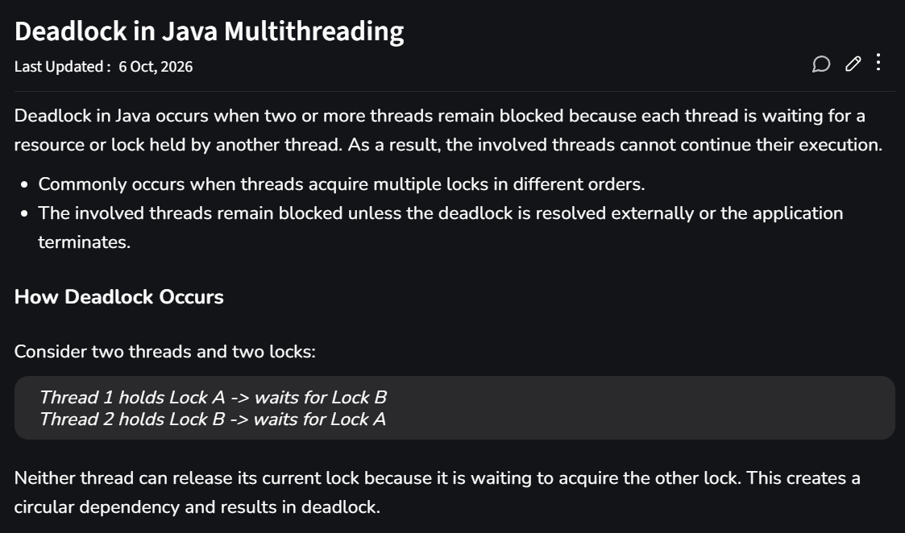
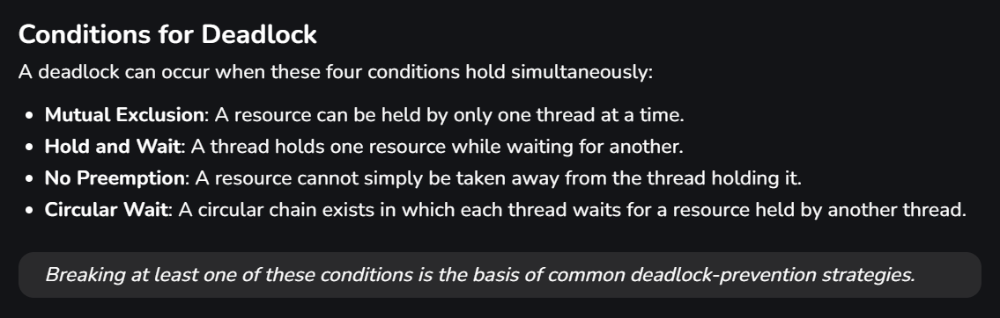
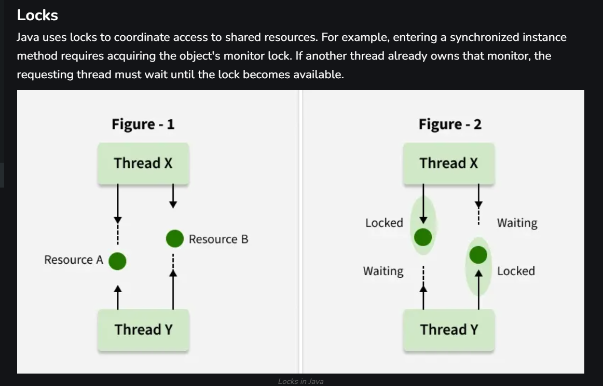
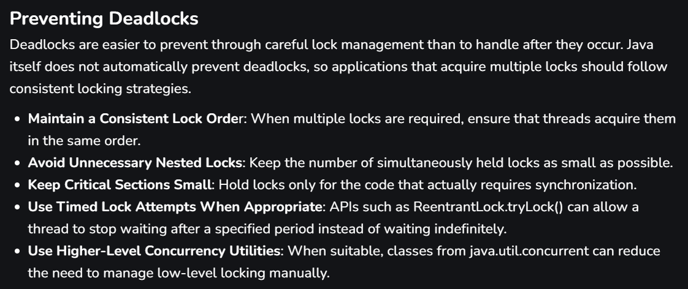

---

```[]
//deadlock demonstration example:


package day16.multithreading;

public class pg19 {
    public static void main(String[] args) {

        final Object lock1 = new Object();
        final Object lock2 = new Object();

        Runnable task1 = () -> {
            synchronized (lock1) {
                System.out.println("Thread A acquired Lock1");
                try {
                    Thread.sleep(100);
                } catch (Exception e) {
                    Thread.currentThread().interrupt();
                }
                synchronized (lock2) {
                    System.out.println("Thread A acquired Lock2");
                }
            }
            ;

        };

        Runnable task2 = () -> {

            synchronized (lock2) {
                System.out.println("Thrad B acquired Lock2");

                try {
                    Thread.sleep(100);
                } catch (Exception e) {
                    Thread.currentThread().interrupt();
                }
                synchronized (lock1) {
                    System.out.println("Thread B acquired Lock1");
                }
            }
        };

        Thread t1 = new Thread(task1);
        Thread t2 = new Thread(task2);
        t1.start();
        t2.start();
    }
}
```
---

```[]
     
    //deadlock prevention , by Maintaining Lock Order:

    package day16.multithreading;

    public class Deadlockpreventionpg20 {

        public static void main(String[] args) {

            final Object lock1 = new Object();
            final Object lock2 = new Object();
            Runnable task1 = () -> {
                synchronized (lock1) {
                    System.out.println("Thread A acquires lock1.");

                    try {
                        Thread.sleep(100);
                    } catch (Exception e) {
                        Thread.currentThread().interrupt();
                    }
                    synchronized (lock2) {
                        System.out.println("Thread A acquires lock2.");
                    }

                }
            };

            Runnable task2 = () -> {
                synchronized (lock1) {
                    System.out.println("Thread B acquires lock1");

                    try {
                        Thread.sleep(100);
                    } catch (Exception e) {
                        Thread.currentThread().interrupt();
                    }
                    synchronized (lock2) {
                        System.out.println("Thread B acquires lock2");
                    }
                }

            };

            Thread t1 = new Thread(task1);
            Thread t2 = new Thread(task2);
            t1.start();
            t2.start();

        }
    }
```

---
### conditions for deadlock


---

### Locks






## Deadlock prevention notes : 

https://www.geeksforgeeks.org/operating-systems/deadlock-prevention/